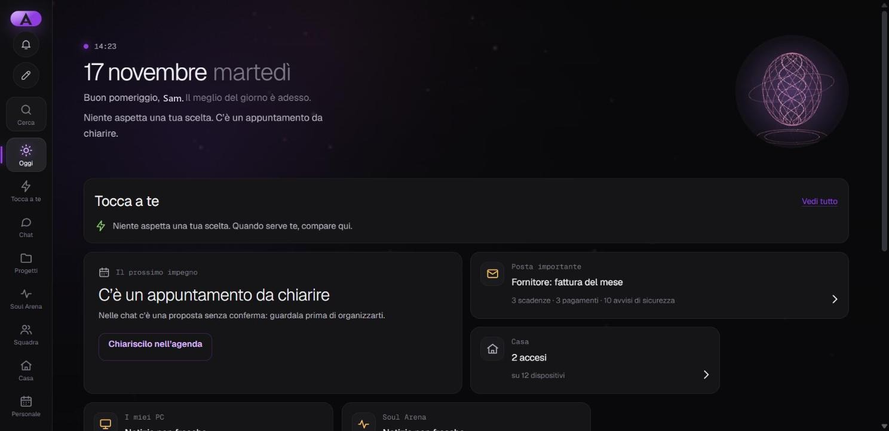
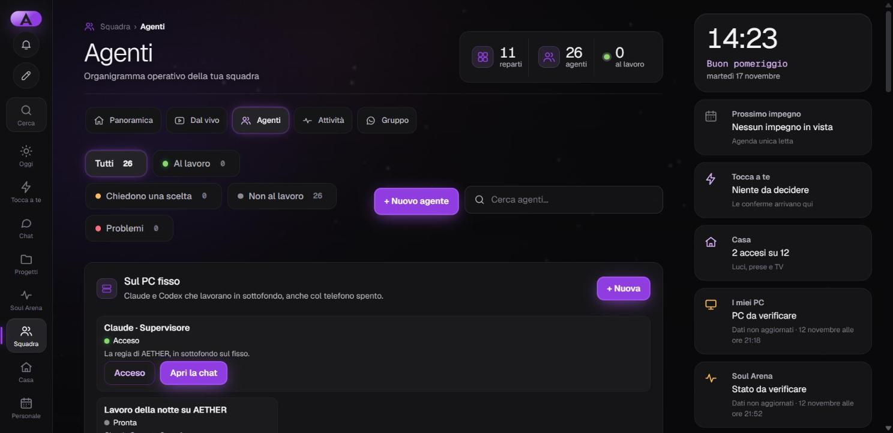
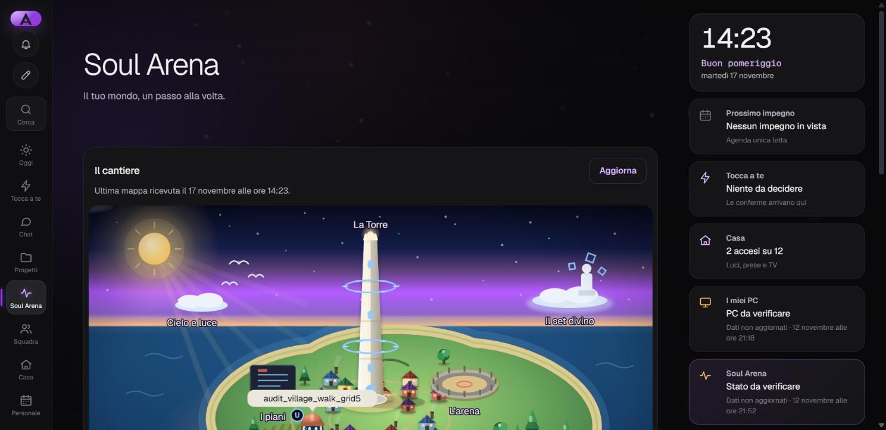
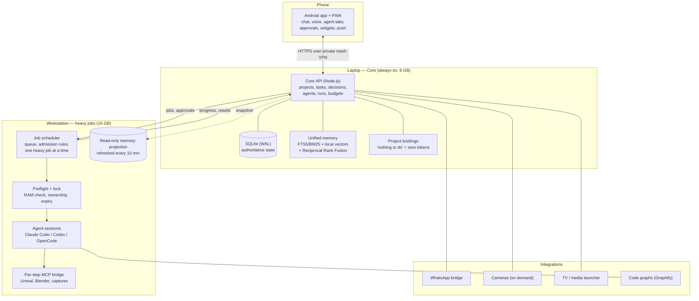

# AETHER — a personal, distributed AI operating system (showcase)

> **Showcase only.** Architecture, screenshots and a short demo of a private system I designed and run every day.
> The source code is private. All rights reserved.

AETHER puts in one place what I need to run many projects with AI agents: what each project needs next,
which agent is working on what, what is waiting for my decision. I talk to it from my phone (voice or text);
agents do the work on the right machine and report back.

The design principle is **coordination separate from execution**: a light, always-on laptop holds the
authoritative state and memory; a workstation runs the heavy jobs (Unreal Engine, Blender, local models,
agent sessions) one at a time, under memory and power guards.

## Screenshots

From the real web app (the interface is in Italian; names of people, clients and private mail are replaced).

## Architecture

## Main parts

- **Core (laptop).** Central registry of projects, tasks, decisions, devices, agents, runs and hand-offs, behind a
  REST/JSON API used by every other surface. SQLite with WAL and foreign keys; consistent backups through the
  SQLite backup API, integrity checks, SHA-256 fingerprints and rotation; watchdog.
- **Memory.** Working, episodic, semantic and profile memory. Retrieval combines full-text search (FTS5/BM25),
  local vectors and Reciprocal Rank Fusion, then builds agent context within a token budget, with sources.
- **Project briefings.** One document per project with status and a to-do list. Automated agents first ask a
  one-line question ("is there work?"): if not, they stop before opening a model — no idle loops, no wasted quota.
- **Agent contracts.** Tasks with dependencies and acceptance criteria; a task without proof stays "code written",
  not "done".
- **Job scheduler (workstation).** Pure planning functions decide what may start from queue, priorities, deadlines,
  time windows and live machine state. Light jobs in parallel, heavy jobs one at a time behind a preflight lock
  that is always released, even on failure. Long agent chains survive provider quota limits and resume on reset.
- **Phone app.** One web front end (no build step) used as a PWA and inside an Android Kotlin WebView shell with
  a native bridge: push-to-talk voice with cancel/lock gestures, native notifications with grouping and
  acknowledgement, home-screen widgets, token encrypted with Android Keystore (AES-GCM).
- **Integrations.** WhatsApp bridge, on-demand camera snapshots, TV/media launcher, code graphs for agents (so they
  find modules without loading whole repositories), MCP tools.

## Stack

Node.js · SQLite (FTS5, WAL) · local vector search · REST/JSON · Kotlin / Android WebView · PWA, Service Worker,
Web Push · PowerShell · MCP · private mesh VPN · Claude Code, Codex, OpenCode, local models via Ollama.

## How it was built

Designed by me and implemented by AI coding agents under written contracts and automated checks, October–November
2026. Core and memory first (October), then the agent engine, the workstation scheduler, the phone app and the
integrations (November). It runs daily and coordinates my other projects, including the Soul Arena game pipeline.

## Licence

© 2026 sas0208. **All rights reserved** — see [LICENSE](LICENSE).
